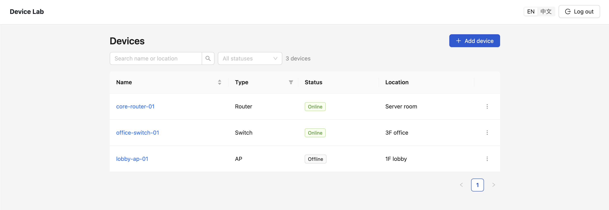
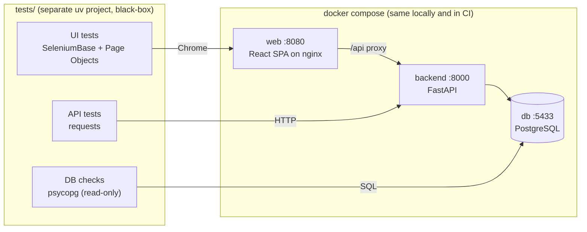
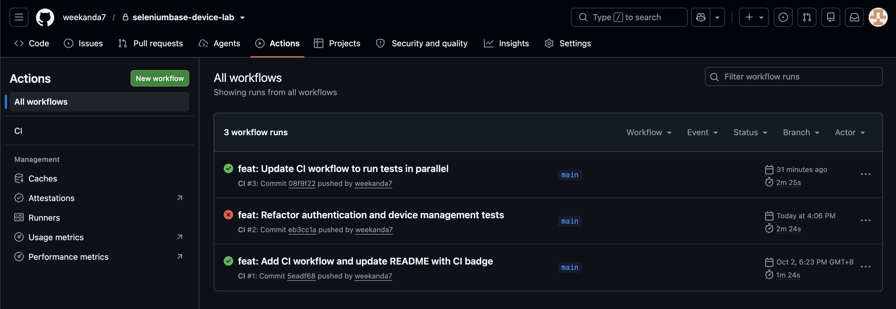
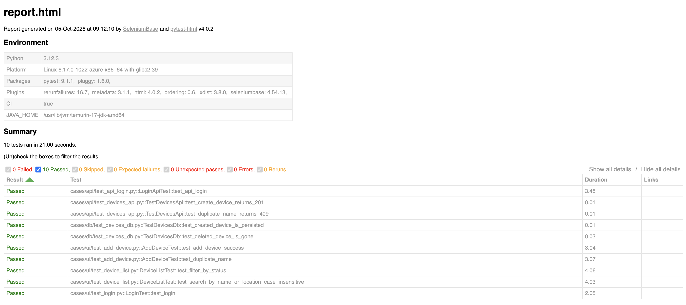

# seleniumbase-device-lab

[](https://github.com/weekanda7/seleniumbase-device-lab/actions/workflows/ci.yml)

A small device-management web app (FastAPI + PostgreSQL + React) **and** a black-box test suite for it:
SeleniumBase UI tests, API tests and DB checks, run in parallel on every push by GitHub Actions.

The app exists to be tested. The interesting part is `tests/`.



## Architecture



- **Black-box**: tests never import app code. They only talk to the three published ports, so the same suite could point at a staging URL by changing env vars (`BASE_URL`, `API_URL`, `DB_DSN`).
- **One environment**: `docker compose up --wait` starts db → backend → web and blocks until every healthcheck is green. Local runs and CI use the exact same command.

## Test design

| Layer | Marker | Tool | What it proves |
|---|---|---|---|
| UI | `ui` | SeleniumBase, Page Objects in `tests/pages/` | A user can log in, search, filter, add, view and delete devices; the detail page uses deferred asserts so one run reports every wrong field |
| API | `api` | `requests` | Status codes and response bodies (201, 409, …) |
| DB | `db` | `psycopg` | What the API actually **persisted**, not just what it echoed back |

**Specs in docstrings**

Each test's docstring holds its Given / When / Then. The same text is the human-readable spec and the input for AI-driven runs (below); API shortcuts are written in parentheses, e.g. `(POST /api/devices -> 201)`.

**Test data**

- Every test creates its own data with a unique `uuid` name and only asserts on that data.
- Setup goes through the API (fast, no UI dependency, still passes the app's validation rules). The DB is only read, never written.
- Cleanup runs even when the test fails: `tearDown` (UI tests) or the `api` fixture (API / DB tests) deletes everything in `created_ids` through the API. Devices created through the UI are looked up by name first.

**Parallel runs**

Because tests share no data and don't depend on order, the whole suite runs with `pytest-xdist -n auto` (one worker per CPU).

**Base classes**

- `NoAuthCase`: starts on the login page.
- `AuthCase`: logs in through the API and puts the token into `sessionStorage`, so UI tests skip the login form.
- Plain method overriding, no abstract classes. With only two subclasses this keeps it simple; the cost is that a subclass must remember to call `super()`.

## AI-driven runs (gwt-run)

An experiment: let an AI run a test case from its GWT docstring alone, through the [SeleniumBase MCP server](https://seleniumbase.io/mcp_servers/) (Pure CDP Mode, no WebDriver), and explain why it failed.

```bash
claude          # in the repo root; .mcp.json registers the seleniumbase MCP server
/gwt-run tests/cases/ui/test_add_device.py::AddDeviceTest::test_duplicate_name --debug
```

How the skill (`.claude/skills/gwt-run/`) keeps the AI predictable:

- **Spec only**: it reads the docstring, not the test code, and looks up request bodies in `/openapi.json`. Fields the GWT doesn't mention follow fixed value rules (default, else the first enum value).
- **Fixed check methods**: one way to check text, URL and API results, so two runs can't take different paths.
- **Verdicts**: PASS / FAIL (the behaviour is wrong) / BLOCKED (the check itself broke), plus a screenshot fallback that is reported but never counts as PASS.
- **Triage** (`references/triage.md`): every non-PASS step is classified in order as environment → testid → test bug → product bug → unknown, with evidence. The product spec (Gherkin in `features.md`, OpenAPI) is the judge, so a wrong GWT and a broken app are told apart.
- **`--debug`**: writes the raw tool output, URL and DOM for each non-PASS step to `tests/report/gwt/`, so someone else can debug without rerunning.

What about ten runs of one case showed: at first the AI saw the same facts and returned PASS once and FAIL once. Each fix narrowed the source of the variance (verdict rules → check method → selector → antd's enter animation) until two runs in a row matched. Both triage scenarios were classified correctly: a wrong expected text in the GWT (test bug, citing the `features.md` line) and a stopped backend (environment: 502 and `/api/version` down).

Trade-off: it is slower and costs tokens, and judgement varies wherever the rules are silent. Regression stays with the pytest suite; the AI is for acceptance runs and first-pass triage of failures.

## Run it

Requires Docker and [uv](https://docs.astral.sh/uv/).

```bash
make up                                   # start db + backend + web, wait for healthchecks
cd tests
uv run pytest --headless -n auto          # everything, in parallel
uv run pytest -m ui --headed              # only UI tests, watch the browser
uv run pytest -m "api or db"              # no browser needed
cd .. && make down                        # stop and wipe the DB (next `up` starts from 3 seed devices)
```

AI-driven run of one case (needs Claude Code; see above): `/gwt-run <pytest node id> [--debug]`.

Reports: `tests/report/report.html` (pytest-html) and `report.xml` (JUnit).

| URL | What |
|---|---|
| http://localhost:8080 | Web UI (login: see `.env.example`) |
| http://localhost:8000/docs | API docs (Swagger) |
| `localhost:5433` | PostgreSQL (`devicelab` / `devicelab`) |

## CI

`.github/workflows/ci.yml` runs five jobs on every push and pull request:

1. **lint**: ruff (backend, tests) and ESLint / Prettier (frontend).
2. **tests-image**: test runner image tagged `deps-<hash of pyproject.toml + uv.lock>`; rebuilt only when dependencies change (test code is mounted by checkout, not baked in).
3. **app-images**: backend / web for this commit → `ghcr.io/weekanda7/device-lab-{backend,web}:sha-<commit>` (version from `git describe`).
4. **test**: steps run **inside the tests image** (`container:`); db / backend / web / Selenium Grid (`selenium/standalone-chrome`) run as `services:` on one Docker network, reached by name (`BASE_URL=http://web`, `--server=chrome --port=4444`) → `pytest --headless -n auto` → upload the HTML / JUnit report.
   - Simplification: in a real team the app is deployed separately and tests point at that environment; here CI deploys it as services.
   - `services:` have no start order, so the backend retries the DB connection and nginx resolves `backend` per request.

5. **pages** (main only, also when tests fail): `scripts/publish-report.sh` adds the report to the `gh-pages` branch as `reports/<date>/run-<n>/`, keeps 7 days and rebuilds the index → **[latest reports](https://weekanda7.github.io/seleniumbase-device-lab/)**. Each publish is one orphan commit (the branch never grows); a `concurrency` group queues publishes so runs can't overwrite each other.

Release: `git tag vX.Y.Z && make release` → `images.yml` builds amd64 + arm64 on native runners and pushes `:vX.Y.Z` + `:latest`.




## Layout

```
backend/            FastAPI: api / application / domain / infrastructure layers
frontend/           React + Vite SPA, served by nginx (proxies /api to the backend)
tests/
  base/             NoAuthCase / AuthCase, uuid_name
  pages/            Page Objects (static methods taking `sb`; shared parts in pages/common)
  api_apiserver/    Auth + DeviceApi clients
  db_client/        read-only Postgres queries
  cases/{ui,api,db} the tests; cases/conftest.py has the `api` fixture
  Dockerfile        test runner image (deps only; code is mounted)
  report/gwt/       gwt-run debug logs and screenshots (git-ignored)
scripts/
  publish-report.sh CI only: publishes the report to gh-pages (refuses to run outside GitHub Actions)
.claude/skills/
  device-lab-dev/   app development rules + Gherkin acceptance criteria (features.md)
  testid-spec/      data-testid naming rules and this repo's mapping table
  gwt-run/          AI-driven GWT runs through the seleniumbase MCP + triage rules
.mcp.json           registers the seleniumbase MCP server for Claude Code
docker-compose.yml
.github/workflows/ci.yml       lint → images → tests (container + services) → pages
.github/workflows/images.yml   release: git tag vX.Y.Z → multi-arch images on GHCR
```

## Security notes

What this demo does on purpose, and what a production setup would change:

- **CI least privilege**: workflows are read-only by default; only the image-building jobs get `packages: write`.
- **No image poisoning**: the tests image tag hashes everything that shapes it (Dockerfile + deps). Only `main` writes the shared `deps-<hash>` tag; PRs push to their own `pr-<n>-…` tag that `main` never reuses.
- **No local secrets in images**: `.env*` is in every `.dockerignore` (anything `VITE_*` would be public in the JS bundle).
- Known trade-offs, accepted for a demo:
  - Third-party actions / images use mutable tags (`@v4`, `:latest`). Production: pin actions to a commit SHA and images to a digest, update with Dependabot.
  - `/api/version` and the login page show version + commit to anyone. Production: show it only after login or on an internal network.
  - Test credentials (`admin` / `admin123`, `devicelab` / `devicelab`) are defaults in compose / CI. Production: secrets, no defaults.
  - Test reports are public (artifacts and GitHub Pages); they may contain the test account typed into the login form. Never put real secrets in the test job's environment.

## Roadmap

- **Typed test inputs**: device status / type as `Enum` instead of strings.
- **TypeScript test layer**: component tests (Vitest) or a Playwright TS e2e for the React frontend.
- **Test management**: push results from `report.xml` (JUnit) to TestRail, so each run maps to test cases and runs there.
- **Cross-browser / real devices**: run the same suite on BrowserStack through its Selenium hub (`--server` / `--port` plus capabilities), no code changes in the tests.
- **Allure Report with history**: trends (pass rate, duration, retries) and flaky detection across runs, with gwt-run's triage results feeding Allure categories; published next to the pytest-html reports on `gh-pages`.
- **gwt-run for every case**: GWT docstrings for the whole suite.
- **Fake-pass detection**: run a case both ways (pytest and gwt-run); a script PASS with a gwt-run FAIL means the script doesn't check what the GWT says.
- **Test maintenance check**: run gwt-run on a schedule to catch tests that drifted from the product (test bugs, testid drift) before they rot.
